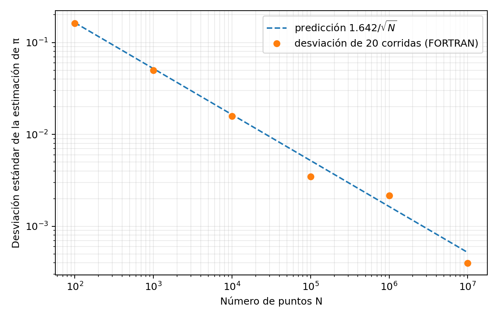

# Taller 5 - Método de Monte Carlo: cálculo de π y convergencia

**Asignatura:** Física Computacional (106018C)  
**Estudiante:** Cristian Andrés Cárdenas Muñoz  
**Código:** 2518531  
**Lenguajes:** Fortran 2008 (cálculo) y Python (visualización y verificación).

## Objetivo

Estimar el número π mediante el método de Monte Carlo, comprobar experimentalmente la ley de convergencia $s\propto 1/\sqrt{N}$, comparar los métodos de valor medio y de acierto y error para integrar $\sin(x)$ en $[0,\pi/2]$, y evaluar el efecto de un generador de números pseudoaleatorios deficiente.

## Archivos

| Archivo | Descripción |
|---|---|
| `05_MonteCarlo_Convergencia.ipynb` | Notebook desarrollado, ejecutado y documentado: ejemplos, partes A-D, gráficas y verificación. |
| `taller5_pi.f90` | Parte A: estimaciónes de pi para $N=10^2,\dots,10^7$ con 20 corridas y ajuste por mínimos cuadrados. |
| `taller5_seno.f90` | Parte B: dos estimadores de la integral de seno y su dispersión estadística. |
| `taller5_lcg.f90` | Parte C: estimador de π con el LCG $(57,1,256)$. |
| `convergencia.dat` | Número de puntos, media y desviación estándar muestral de las estimaciónes de π. |
| `pendiente.dat` | Pendiente del ajuste log-log calculada en Fortran. |
| `seno.dat` | Medias y desviaciones estándar muestrales de ambos métodos de integración. |
| `lcg.dat` | Estimaciones de π utilizando el generador deficiente. |
| `convergencia_pi.png` | Gráfica experimental de convergencia comparada con la predicción teórica. |
| `salida_programa.txt` | Registro de la salida de los tres programas Fortran. |
| `verificacion_pass_fail.txt` | Resultados de los cinco controles automáticos. |

## Resultados destacados

- Con $N=10^7$, la media de 20 estimaciónes es **3.141530**, frente a $\pi\approx3.141593$.
- La pendiente experimental es **-0.5079**, cercana a $-0.5$.
- La integral exacta es 1. Medias: **0.999731** (valor medio) y **1.000085** (acierto y error).
- El LCG converge incorrectamente a **3.093750** pese a aumentar el número de puntos.
- **Verificación automática: 5/5 PASS.** Los resultados mostrados provienen de una ejecución comprobada con `gfortran`.



## Reproducción

1. Abra `05_MonteCarlo_Convergencia.ipynb` en Google Colab y ejecute todas las celdas en orden. El propio notebook instala/verifica `gfortran` y genera los datos.
2. Para ejecutar solo los programas desde una terminal que tenga `gfortran`, use:

```bash
gfortran -std=f2008 -O2 -fcheck=all taller5_pi.f90 -o taller5_pi && ./taller5_pi
gfortran -std=f2008 -O2 -fcheck=all taller5_seno.f90 -o taller5_seno && ./taller5_seno
gfortran -std=f2008 -O2 -fcheck=all taller5_lcg.f90 -o taller5_lcg && ./taller5_lcg
```

3. Los datos generados pueden variar si cambia la implementación del generador pseudoaleatorio. La verificacion permite fluctuaciones estadísticas razonables.

## Observaciones

La reducción del error por Monte Carlo depende de que las muestras representen adecuadamente la distribución objetivo. La parte del LCG ilustra que muchos puntos no sustituyen un buen generador pseudoaleatorio. La comparacion de dos métodos de integración también muestra por qué conviene medir dispersión a lo largo de varias corridas, no solo observar una estimación.

## Uso de herramientas de IA

Se utilizo ChatGPT como supervisor, mentor en dudas puntuales y ayuda en la redaccion. La declaración final se incluirá también en el informe.
